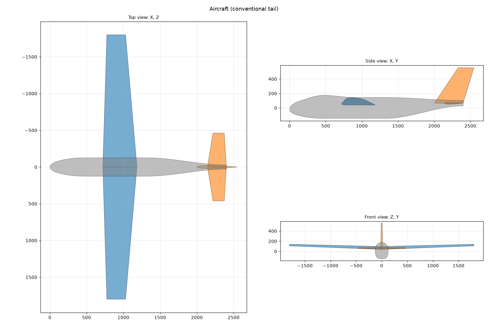

# Parametric Aircraft for SolidWorks

Design a complete fixed-wing aircraft (wing, fuselage and tail) from one
configuration file and build it in SolidWorks as a single solid body. You can
edit every parameter in a desktop GUI with live validation and a three-view
preview. A design sweep can generate whole families of aircraft. Only designs
that satisfy every parameter limit and every cross-component rule are built.



*The default design: a 3.6 m span, high-wing UAV with a conventional tail.*

---

## Contents

- [Features](#features)
- [Requirements](#requirements)
- [Installation](#installation)
- [Quick start](#quick-start)
- [Project structure](#project-structure)
- [How the aircraft is built](#how-the-aircraft-is-built)
- [The configuration file](#the-configuration-file)
- [Parameter reference](#parameter-reference)
- [Cross-component constraints](#cross-component-constraints)
- [The GUI (Aircraft Designer)](#the-gui-aircraft-designer)
- [Design sweep](#design-sweep)
- [Command-line reference](#command-line-reference)
- [The SolidWorks model](#the-solidworks-model)
- [Using the component scripts on their own](#using-the-component-scripts-on-their-own)
- [Extending the project](#extending-the-project)
- [Troubleshooting](#troubleshooting)

---

## Features

- **One configuration file.** [`aircraft_config.json`](aircraft_config.json)
  defines every geometric parameter of the wing, fuselage and tail. Each
  parameter has its own allowed range, and 23 cross-component rules keep the
  three parts compatible.
- **Realistic components.**
  - **Wing:** tapered, swept, dihedral and twisted, with NACA 4-digit or
    Selig/Lednicer `.dat` airfoils.
  - **Fuselage:** superellipse cross-sections, a drooped nose, an avionics or
    canopy hump, a constant mid-body and an upswept tail cone.
  - **Tail:** seven layouts, sized with tail volume coefficients: conventional,
    T, cruciform, H, V, inverted V and Y.
- **Automatic integration.** The wing height is solved so its root always sits
  inside the fuselage. The tail is placed on the tail cone, and the tail arm
  and tail size are iterated until they agree.
- **Safe by design.** Nothing is built unless every value is inside its range,
  every constraint holds, and the hard fit checks pass (the roots fit and the
  tail does not overlap the wing). The same checks run in the GUI, on the
  command line and in the design sweep.
- **Desktop GUI** (CustomTkinter), with:
  - sliders and number fields limited to each parameter's range;
  - live checking after every change;
  - rendered formulas for each parameter and rule;
  - a three-view preview that always fits the complete aircraft;
  - light and dark themes.
- **Design sweep.** Iterate any parameters (min, max, number of iterations, or
  a list of options) by full grid, linked or Latin-hypercube sampling. Export
  the valid designs and build them all in SolidWorks.
- **Re-runnable models.** Re-building in the same part deletes the previous
  aircraft first, so the model always follows the parameters. Every parameter
  and derived value is also written into SolidWorks as a global variable.

---

## Requirements

| | |
|---|---|
| OS | Windows (SolidWorks automation uses COM). Validation, preview and the sweep also run without SolidWorks. |
| SolidWorks | Any recent version, with a **default part template** set (*Tools › Options › System Options › Default Templates*). |
| Python | 3.10 or newer (developed with 3.14) |
| Packages | `numpy`, `matplotlib`, `customtkinter`, `pillow` (GUI) and `pywin32` (SolidWorks), listed in [`requirements.txt`](requirements.txt) |

Versions used during development: numpy 2.5.3, matplotlib 3.11.2,
customtkinter 6.0.0, pillow 12.3.0, pywin32 312.

---

## Installation

**The easy way:** double-click [`run_bat.bat`](run_bat.bat). On the first run
it:
1. creates a virtual environment in `.venv`;
2. installs [`requirements.txt`](requirements.txt);
3. starts the GUI.

Later runs start straight away. The packages are reinstalled only when
`requirements.txt` has changed. Python 3.10 or newer must be installed, with
*"Add python.exe to PATH"* ticked, or the `py` launcher available.

```bat
run_bat.bat                 :: start the GUI
run_bat.bat my_uav.json     :: start the GUI with another configuration
run_bat.bat --install       :: only set up / update the environment
```

**Manually:**

```powershell
cd d:\FUll_aircraft_Solidworks_parametric_modelling
python -m venv .venv
.\.venv\Scripts\activate
pip install -r requirements.txt
```

To check that Python can reach SolidWorks:

```powershell
python connect.py
```

It attaches to a running SolidWorks (or starts one) and prints its revision.

---

## Quick start

**GUI (recommended):** double-click `run_bat.bat`, or

```powershell
python aircraft_gui.py                      # opens aircraft_config.json
python aircraft_gui.py my_uav.json          # or another configuration
```

**Command line:**

```powershell
python aircraft_sw.py --check               # validate + full report, no SolidWorks
python aircraft_sw.py --check --plot        # ... and write aircraft_preview.png
python aircraft_sw.py                       # build in SolidWorks
python aircraft_sw.py --set wing.span_mm=4000 --set tail.configuration=v_tail
python aircraft_sw.py --save C:\work\uav.SLDPRT --new-part
```

**Design sweep:**

```powershell
python aircraft_sweep.py run --vary wing.span_mm=3000:4200:5 --vary tail.configuration=conventional,v_tail --out designs
python aircraft_sweep.py build designs      # one .SLDPRT per valid design
```

---

## Project structure

| File | Purpose |
|---|---|
| [`aircraft_config.json`](aircraft_config.json) | **The single source of truth:** all parameters with ranges, the constraint rules and the saved design sweep |
| [`aircraft_gui.py`](aircraft_gui.py) | Desktop GUI: editing, live checks, preview, design sweep, build and export |
| [`aircraft_sw.py`](aircraft_sw.py) | Loads and validates the configuration, integrates the three components, evaluates constraints, builds the aircraft in SolidWorks, reports and plots |
| [`aircraft_sweep.py`](aircraft_sweep.py) | Design sweep engine and CLI: sampling, checking, export, batch build |
| [`wing_solidworks.py`](wing_solidworks.py) | Wing geometry (planform, airfoils, sections) and SolidWorks wing builder; also usable on its own |
| [`fuselage_sw.py`](fuselage_sw.py) | Fuselage geometry (body lines, superellipse sections) and SolidWorks fuselage builder; also usable on its own |
| [`tail_sw.py`](tail_sw.py) | Tail geometry (7 layouts, volume-coefficient sizing) and SolidWorks tail builder; also usable on its own |
| [`connect.py`](connect.py) | Small connection test for the SolidWorks COM interface |
| [`requirements.txt`](requirements.txt) | Python package requirements |
| [`run_bat.bat`](run_bat.bat) | Windows launcher: sets up `.venv` on the first run, then starts the GUI |
| `*_preview.png` | Preview images written by the `--plot` options |
| `*.SLDPRT` | Saved SolidWorks parts |

The three component modules provide the geometry. `aircraft_sw.py` combines
them, and the GUI and the sweep both use `aircraft_sw.py`, so every entry
point applies exactly the same checks.

```
aircraft_gui.py ──┐
                  ├──> aircraft_sw.py ──> wing_solidworks.py
aircraft_sweep.py ┘          │        ──> fuselage_sw.py
                             │        ──> tail_sw.py
                             └──> SolidWorks (COM, pywin32)
```

---

## How the aircraft is built

### Coordinate system and units

All lengths are in **millimetres** and all angles in **degrees**.

| Axis | Direction | Origin |
|---|---|---|
| X | along the fuselage, **+ aft** | fuselage nose tip |
| Y | vertical, **+ up** | fuselage reference line |
| Z | spanwise / lateral | aircraft plane of symmetry |

Sign conventions:
- **Sweep:** + is swept back.
- **Dihedral:** + is tips up.
- **Twist:** + is tip nose-up, so negative twist is washout.
- **Incidence:** + is nose-up.

### Integration steps (`aircraft_sw.integrate`)

1. **Validate.** Every parameter is checked against its type and its
   `[min, max]`, `choices` or `pattern`. Derived fields such as the tail arm
   cannot be set by hand.
2. **Fuselage.** The body lines (top, bottom, half-width and section exponent
   as functions of x) and the cross-section stations are computed. Stations
   are clustered in the nose and tail, where curvature is highest.
3. **Wing.**
   - The root leading edge goes at `x = wing_x_frac · L`, rotated by
     `wing_incidence_deg`.
   - The root height is solved so the rotated root airfoil fits between the
     fuselage's top and bottom lines. `wing_vertical_pos` chooses where:
     −1 lowest, 0 middle, +1 highest that still fits.
4. **Tail.**
   - The tail is placed so its aft-most root trailing edge is at the fuselage
     end, plus `tail_overhang_frac` × the tail root chord.
   - The tail arm follows from that position. The surfaces are then re-sized
     with the volume coefficients:
     - stabiliser area `S_h = V_h · S_w · MAC_w / l_t`
     - fin area `S_v = V_v · S_w · b_w / l_t`
     - where `S_w` is the wing area, `MAC_w` the wing's mean aerodynamic
       chord, `b_w` the wing span and `l_t` the tail arm.
   - Placing and re-sizing are repeated until the arm converges.
   - V-type tails use the Purser–Campbell rule: total panel area
     `S = S_h + S_v` and panel angle `Γ = atan(√(S_v/S_h))`.
5. **Fit the tail vertically.** The tail root height is solved inside the
   tail cone with `tail_vertical_pos`, the same way as the wing.
6. **Derived values.** About 40 derived values are computed, such as wing area,
   MAC, tail arm, root fits, wing–tail gap and overall dimensions.
   `python aircraft_sw.py --check` lists them all.
7. **Check.** All constraint expressions and the hard fit checks are
   evaluated. The aircraft is only built if all of them pass.

---

## The configuration file

[`aircraft_config.json`](aircraft_config.json) has six top-level entries:

| Key | Content |
|---|---|
| `_about` | Comments (ignored) |
| `wing`, `fuselage`, `tail`, `integration` | Parameters, one entry per parameter |
| `constraints` | List of cross-component rules |
| `sweep` | Saved design-sweep definition (optional; used by the GUI and `aircraft_sweep.py`) |

### Parameter entries

Numeric parameter:

```json
"span_mm": {"value": 3600.0, "min": 500.0, "max": 30000.0, "unit": "mm",
            "description": "Full tip-to-tip span b"}
```

Choice parameter, and text parameter with a pattern:

```json
"configuration": {"value": "conventional", "choices": ["conventional", "t_tail", "..."], ...}
"naca":          {"value": "0010", "pattern": "^00[0-9]{2}$", ...}
```

Rules for the file:
- Every parameter of every section must be present.
- Integer parameters must be whole numbers.
- A value outside its range rejects the whole configuration, with a message
  naming the parameter.

### Constraint entries

```json
{"name": "tail_arm_to_mac",
 "expr": "derived.tail_arm_mm / derived.wing_mac_mm",
 "min": 2.0, "max": 5.0,
 "description": "Tail arm in wing MACs (typical 2.5-4)"}
```

Expressions are evaluated by a small, safe evaluator, not Python's `eval`. They
may use:
- **Variables:** `wing.<name>`, `fuselage.<name>`, `tail.<name>`,
  `integration.<name>` and `derived.<name>`.
- **Operators:** `+ − * / **` and parentheses.
- **Functions:** `sqrt`, `abs`, `min`, `max`, and `sin`, `cos`, `tan` (in
  degrees).

### Saved design sweep

```json
"sweep": {
  "mode": "grid", "samples": 20, "seed": 1, "fill_valid": true,
  "variables": [
    {"param": "wing.span_mm", "min": 3000, "max": 4200, "count": 5},
    {"param": "tail.configuration", "values": ["conventional", "v_tail"]}
  ]
}
```

The GUI writes this block when you save. It is ignored when building a single
aircraft.

---

## Parameter reference

These are the defaults in `aircraft_config.json`. Together they describe a
conventional, high-wing UAV:
- 3.6 m span, aspect ratio 10, wing area 1.30 m², MAC 370 mm
- 2.4 m fuselage
- tail arm 3.8 MAC; stabiliser 14.6 % and fin 11.6 % of the wing area

The defaults satisfy every constraint, with all seven tail layouts.

#### `wing`

| Parameter | Default | Allowed | Unit | Meaning |
|---|---|---|---|---|
| `span_mm` | 3600 | 500 – 30000 | mm | Full tip-to-tip span b |
| `aspect_ratio` | 10 | 4 – 25 |  | Span squared divided by the wing area |
| `taper_ratio` | 0.55 | 0.2 – 1 |  | Tip chord divided by the root chord |
| `sweep_deg` | 0 | -10 – 35 | ° | Sweep of the reference chord line (+ = swept back) |
| `sweep_ref` | 0.25 | 0 – 1 |  | Chord fraction the sweep is measured on (0 = leading edge, 0.25 = quarter chord) |
| `dihedral_deg` | 2 | -5 – 10 | ° | Dihedral angle (+ = tips up) |
| `twist_deg` | -2 | -6 – 2 | ° | Tip twist relative to the root (negative = washout) |
| `twist_axis` | 0.25 | 0 – 1 |  | Chord fraction the sections are twisted about |
| `n_stations` | 6 | 2 – 12 |  | Loft sections from root to tip |
| `naca` | `4412` | 4 digits |  | NACA 4-digit section (used when no airfoil file is set) |
| `airfoil_file` | (empty) | empty or `.dat` path |  | Selig / Lednicer .dat file; empty = use the NACA section |
| `n_points_per_surface` | 0 | 0 – 200 |  | 0 = use the airfoil points as they are, > 0 = cosine resampling |

#### `fuselage`

| Parameter | Default | Allowed | Unit | Meaning |
|---|---|---|---|---|
| `length_mm` | 2400 | 300 – 30000 | mm | Total length L, nose tip to tail end |
| `max_width_mm` | 250 | 30 – 4000 | mm | Maximum width W |
| `max_height_mm` | 290 | 30 – 4000 | mm | Maximum height H (without the canopy hump) |
| `nose_frac` | 0.2 | 0.08 – 0.35 |  | Nose length as a fraction of the fuselage length |
| `tail_frac` | 0.45 | 0.25 – 0.6 |  | Tail-cone length as a fraction of the fuselage length |
| `nose_bluntness` | 2 | 1.3 – 4 |  | 2 = elliptical nose, > 2 blunter, < 2 more pointed |
| `nose_droop` | -0.15 | -0.7 – 0.3 |  | Nose tip height relative to half the height (negative = below the centreline) |
| `section_n_top` | 2.3 | 1.8 – 5 |  | Superellipse exponent of the upper half (2 = ellipse, larger = boxier) |
| `section_n_bottom` | 2.8 | 1.8 – 6 |  | Superellipse exponent of the lower half (larger = flatter floor) |
| `section_n_nose` | 2 | 1.8 – 3 |  | Section exponent at the nose tip |
| `section_n_tail` | 2 | 1.8 – 3 |  | Section exponent at the tail end |
| `canopy_start_frac` | 0.08 | 0 – 0.5 |  | Start of the canopy / avionics hump as a fraction of the length |
| `canopy_length_frac` | 0.3 | 0.05 – 0.6 |  | Length of the hump as a fraction of the fuselage length |
| `canopy_height_mm` | 30 | 0 – 1000 | mm | Extra height at the hump peak (0 = no hump) |
| `canopy_peak_pos` | 0.4 | 0.1 – 0.9 |  | Peak position within the hump (0 = front, 1 = rear) |
| `tail_end_width_mm` | 55 | 0 – 1000 | mm | Width of the tail-end section (0 together with the height = pointed tail) |
| `tail_end_height_mm` | 75 | 0 – 1000 | mm | Height of the tail-end section |
| `tail_upsweep` | 0.45 | -0.2 – 0.9 |  | Tail-end centre height relative to half the height (+ = up) |
| `tail_shape` | 1 | 0.5 – 2.5 |  | 1 = smooth cubic taper, > 1 keeps the body full for longer |
| `n_nose_stations` | 9 | 3 – 30 |  | Loft sections in the nose |
| `n_mid_stations` | 4 | 0 – 20 |  | Loft sections in the mid-body |
| `n_tail_stations` | 8 | 3 – 30 |  | Loft sections in the tail cone |
| `n_section_points` | 40 | 16 – 120 |  | Spline points around each section |

The cross-sections are superellipses, `|y/b|ⁿ + |z/a|ⁿ = 1`, where `a` is the
half width, `b` the upper or lower half height, and `n` the exponent. The upper
and lower halves have separate exponents, which blend to the nose and tail
values along the body.

#### `tail`

| Parameter | Default | Allowed | Unit | Meaning |
|---|---|---|---|---|
| `configuration` | `conventional` | `conventional`, `t_tail`, `cruciform`, `h_tail`, `v_tail`, `inverted_v`, `y_tail` |  | Empennage layout |
| `vh` | 0.55 | 0.3 – 0.9 |  | Horizontal tail volume coefficient |
| `vv` | 0.045 | 0.02 – 0.09 |  | Vertical tail volume coefficient |
| `h_area_mm2` | 0 | 0 – 100,000,000 | mm² | Fixed stabiliser area (0 = size it from the volume coefficient Vh) |
| `v_area_mm2` | 0 | 0 – 100,000,000 | mm² | Fixed fin area (0 = size it from the volume coefficient Vv) |
| `h_aspect_ratio` | 4.5 | 2.5 – 7 |  | Stabiliser aspect ratio (also used for the V-tail panels) |
| `h_taper_ratio` | 0.6 | 0.3 – 1 |  | Stabiliser tip chord divided by its root chord |
| `h_sweep_deg` | 6 | 0 – 40 | ° | Stabiliser quarter-chord sweep |
| `h_dihedral_deg` | 0 | -10 – 15 | ° | Stabiliser dihedral (ignored for V-tails) |
| `h_incidence_deg` | -1 | -5 – 3 | ° | Stabiliser setting angle (+ = nose up) |
| `v_aspect_ratio` | 1.6 | 0.8 – 2.5 |  | Fin aspect ratio (per fin) |
| `v_taper_ratio` | 0.55 | 0.3 – 1 |  | Fin tip chord divided by its root chord |
| `v_sweep_deg` | 30 | 0 – 55 | ° | Fin quarter-chord sweep |
| `v_tail_angle_deg` | 0 | 0 – 60 | ° | Panel angle of V, inverted-V and Y tails; 0 = automatic (Purser-Campbell), otherwise 15 to 60 |
| `stab_height_frac` | 0.5 | 0.2 – 0.9 |  | Cruciform: stabiliser height as a fraction of the fin height |
| `fin_below_frac` | 0.3 | 0.05 – 0.55 |  | H-tail: share of each endplate fin below the stabiliser |
| `ventral_fin_frac` | 0.3 | 0.05 – 0.55 |  | Y-tail: share of the fin area carried by the ventral fin |
| `fin_x_offset_mm` | 0 | -500 – 500 | mm | Move the fin(s) aft (+) or forward (-) from the default position |
| `naca` | `0010` | `00xx` (symmetric) |  | Symmetric NACA 4-digit section for all tail surfaces |
| `airfoil_file` | (empty) | empty or `.dat` path |  | .dat file used instead of the NACA section |
| `n_points_per_surface` | 0 | 0 – 200 |  | 0 = use the airfoil points as they are, > 0 = cosine resampling |

The seven tail layouts:

| Layout | Description |
|---|---|
| `conventional` | Low-set horizontal stabiliser and a single vertical fin |
| `t_tail` | Stabiliser on top of the fin |
| `cruciform` | Stabiliser part-way up the fin (`stab_height_frac`) |
| `h_tail` | Stabiliser with twin endplate fins (`fin_below_frac`) |
| `v_tail` | Two inclined panels (ruddervators) |
| `inverted_v` | V-tail pointing down (A-tail) |
| `y_tail` | V-tail plus a ventral fin (`ventral_fin_frac`), MQ-9 style |

Parameters that do not apply to the chosen layout are ignored, and the GUI
greys them out. For example, fin aspect ratio, taper and sweep do nothing for a
V-tail.

#### `integration`

| Parameter | Default | Allowed | Unit | Meaning |
|---|---|---|---|---|
| `wing_x_frac` | 0.3 | 0.15 – 0.55 |  | Wing root leading-edge position as a fraction of the fuselage length |
| `wing_vertical_pos` | 0.6 | -1 – 1 |  | -1 = low wing, 0 = mid wing, +1 = high wing (the root always stays inside the fuselage) |
| `wing_incidence_deg` | 2 | -3 – 6 | ° | Wing root setting angle relative to the fuselage axis (+ = nose up) |
| `tail_overhang_frac` | 0 | -0.5 – 0.4 |  | How far the tail root trailing edge reaches past the fuselage end, as a fraction of the tail root chord (negative = ahead of the end) |
| `tail_vertical_pos` | 0 | -1 – 1 |  | Tail root height within the tail cone: -1 = lowest, 0 = middle, +1 = highest that still fits |

---

## Cross-component constraints

Every rule must hold before the aircraft is built. The limits are in the
`constraints` list of the configuration file and can be edited there.

| Rule | Expression | Allowed | Purpose |
|---|---|---|---|
| `fuselage_length_to_span` | `fuselage.length_mm / wing.span_mm` | 0.35 – 1.2 | Fuselage length versus wing span (UAVs 0.45-0.8, light aircraft 0.7-0.9) |
| `fuselage_width_to_span` | `fuselage.max_width_mm / wing.span_mm` | 0.03 – 0.2 | Fuselage must not swallow too much of the wing span |
| `fuselage_fineness` | `fuselage.length_mm / sqrt(fuselage.max_width_mm * fuselage.max_height_mm)` | 4 – 14 | Fineness ratio: length over the equivalent diameter |
| `fuselage_height_to_width` | `fuselage.max_height_mm / fuselage.max_width_mm` | 0.6 – 1.8 | Cross-section aspect: height over width |
| `fuselage_nose_plus_tail` | `fuselage.nose_frac + fuselage.tail_frac` | 0.3 – 0.9 | Leaves a mid-body for the wing box |
| `canopy_within_body` | `fuselage.canopy_start_frac + fuselage.canopy_length_frac` | 0 – 0.7 | Hump ends before the tail cone region |
| `canopy_height_ratio` | `fuselage.canopy_height_mm / fuselage.max_height_mm` | 0 – 0.35 | Hump height vs fuselage height |
| `tail_end_width_ratio` | `fuselage.tail_end_width_mm / fuselage.max_width_mm` | 0 – 0.5 | Tail-end section vs max section |
| `tail_end_height_ratio` | `fuselage.tail_end_height_mm / fuselage.max_height_mm` | 0 – 0.6 | Tail-end section vs max section |
| `wing_root_chord_to_length` | `derived.wing_root_chord_mm / fuselage.length_mm` | 0.08 – 0.4 | Wing root chord vs fuselage length |
| `wing_root_thickness_ratio` | `derived.wing_root_thickness_mm / derived.fuselage_height_at_wing_mm` | 0 – 0.85 | Wing root thickness must fit in the local fuselage height |
| `wing_root_fit` | `derived.wing_root_fit_mm / fuselage.max_height_mm` | 0 – 10 | Vertical room for the wing root inside the fuselage (< 0 = root sticks out) |
| `wing_root_te_position` | `derived.wing_root_te_x_mm / fuselage.length_mm` | 0.2 – 0.75 | Wing root trailing edge stays ahead of the thin tail cone |
| `wing_exposed_span` | `1 - fuselage.max_width_mm / wing.span_mm` | 0.8 – 1 | Share of the span outside the fuselage |
| `tail_arm_to_mac` | `derived.tail_arm_mm / derived.wing_mac_mm` | 2 – 5 | Tail arm in wing MACs (typical 2.5-4) |
| `wing_tail_gap` | `derived.wing_tail_gap_mm / derived.wing_mac_mm` | 0.25 – 10 | Tail leading edge behind the wing trailing edge, in wing MACs |
| `stab_span_to_wing_span` | `derived.tail_span_mm / wing.span_mm` | 0.15 – 0.5 | Tail span vs wing span |
| `fin_height_to_fuselage` | `derived.tail_height_mm / fuselage.max_height_mm` | 0.4 – 5 | Vertical extent of the tail from its root (up or down) vs fuselage height |
| `tail_root_fit` | `derived.tail_root_fit_mm / fuselage.max_height_mm` | 0 – 10 | Vertical room for the tail root inside the tail cone (< 0 = does not fit) |
| `tail_root_on_fuselage` | `derived.tail_root_overlap_frac` | 0.55 – 1 | Share of the tail root chord attached to the fuselage |
| `tail_below_fuselage` | `derived.tail_below_fuselage_mm / fuselage.max_height_mm` | -10 – 1 | How far tail surfaces hang below the fuselage bottom |
| `tail_volume_h` | `derived.tail_vh_ratio` | 0.85 – 1.15 | Achieved over target Vh (always 1 when a fixed stabiliser area is given) |
| `tail_volume_v` | `derived.tail_vv_ratio` | 0.85 – 1.15 | Achieved over target Vv (always 1 when a fixed fin area is given) |

In addition, these **hard checks** always apply, whatever the configuration:
- the wing root fits inside the fuselage;
- the tail root fits inside the tail cone;
- the tail root is attached to the fuselage;
- the tail does not overlap the wing in x;
- the wing span is larger than the fuselage width.

Some geometry cannot be constructed at all. For example, with a very short
fuselage there may be no room for the tail behind the wing. That is reported
as an error that names the parameters to change.

### Derived values available to constraints

Run `python aircraft_sw.py --check` to see every derived value for the current
configuration. They include:

- **Wing:** `wing_area_mm2`, `wing_root_chord_mm`, `wing_tip_chord_mm`,
  `wing_mac_mm`, `wing_sweep_le_deg`, `wing_root_le_x_mm`, `wing_root_te_x_mm`,
  `wing_ac_x_mm`, `wing_root_y_mm`, `wing_root_thickness_mm`,
  `wing_root_fit_mm`, `wing_tip_y_mm`.
- **Fuselage:** `fuselage_height_at_wing_mm`, `fuselage_nose_end_x_mm`,
  `fuselage_tail_start_x_mm`, `fuselage_fineness`, `fuselage_top_max_mm`,
  `fuselage_bottom_min_mm`.
- **Tail:** `tail_arm_mm`, `tail_origin_x_mm`, `tail_origin_y_mm`,
  `tail_s_h_mm2`, `tail_s_v_mm2`, `tail_v_angle_deg`, `tail_vh_effective`,
  `tail_vv_effective`, `tail_vh_ratio`, `tail_vv_ratio`, `tail_le_min_x_mm`,
  `tail_te_max_x_mm`, `tail_span_mm`, `tail_height_mm`, `tail_root_fit_mm`,
  `tail_root_overlap_frac`, `tail_below_fuselage_mm`.
- **Aircraft:** `wing_tail_gap_mm`, `aircraft_length_mm`, `aircraft_span_mm`,
  `aircraft_height_mm`.

---

## The GUI (Aircraft Designer)

```powershell
python aircraft_gui.py [config.json]
```

### Layout

| Area | Content |
|---|---|
| **Sidebar** | Pages: Wing, Fuselage, Tail, Placement, Constraints, Design sweep, Build & Export. Red badges count the problems on each page; the blue badge counts iterated parameters. File buttons: Open, Save, Save as, Reset all. Appearance (Light / Dark / System) and UI scale. |
| **Parameter pages** | Parameters grouped into cards. Each row has: a status dot, the name and description (with the rendered formula where there is one), a slider, a number field, the unit, the min/max line, an **Iterate** button and a reset button (↺). A filter box searches by name or description. |
| **Status card** (top right) | "✓ Ready to build" or "✗ N issues" with the first problem (hover for the full text), and the **Build** button. |
| **Preview** tab | Live top, side and front views, with the tail arm dimensioned |
| **Checks** tab | Every problem in plain words, and which pages it involves |
| **Data** tab | Key figures (wing area, MAC, chords, tail arm, tail areas, achieved Vh/Vv, root fits) and every derived value |

### Input validation

- **Sliders** move only within the parameter's range.
- **Number fields** filter keystrokes:
  - only number syntax is accepted;
  - a minus sign is rejected when the minimum is 0 or more;
  - digits that would go past the limits are rejected.
- A value **below the minimum while typing** turns the field red and is not
  used. On **Enter** or leaving the field, out-of-range values snap to the
  nearest limit, with a message in the status bar.
- **Choice and text fields:** the tail layout is a dropdown; NACA codes are
  checked against their pattern (the tail code must be symmetric, `00xx`);
  airfoil files are picked with *Browse* and must exist.
- **Parameters that don't apply** to the current settings are greyed out:
  - fin settings for a V-tail;
  - the V-panel angle except for V-type tails;
  - the NACA code when an airfoil file is set;
  - the hump shape when the hump height is 0.

### Live checking

After every change (about 0.2 s after you stop typing or sliding), the whole
aircraft is integrated and checked:
- Parameters involved in a broken rule get an amber or red dot; hover for the
  reason.
- The page badges, the Constraints page and the status card update.
- **Build stays disabled** until everything passes.

If the current settings cannot be drawn at all, the preview keeps the previous
design and says so.

### Preview

- The three views are resized from the aircraft's proportions whenever the
  geometry changes or the window is resized, so the complete aircraft is always
  visible.
- Margins are sized to the label fonts, so labels are never clipped.
- For extreme proportions (very large span or a very long fuselage), every view
  keeps a readable height.
- While you drag a slider, the preview waits and redraws once when you release.

### Building and exporting (Build & Export page)

- **Always create a new part.** When this is off, the aircraft in the active
  SolidWorks part is rebuilt in place.
- **Save part as.** An optional `.SLDPRT` path.
- **Build aircraft in SolidWorks.** Runs `aircraft_sw.py` with the current
  values (written to `%TEMP%\aircraft_designer_config.json`) and streams the
  log into the page.
- **Export preview image…** Saves a PNG three-view drawing.
- **Export report…** Saves a text report: parameters with ranges, derived
  values, constraint results and any issues.

### Files and shortcuts

- **Ctrl+S** saves and **Ctrl+O** opens a configuration. The title bar shows
  unsaved changes, and you are asked before closing with unsaved work.
- Saving writes the configuration with one parameter per line, including the
  sweep definition.
- **Reset all** and the per-row **↺** buttons return to the values in the
  loaded file.
- Rendered formula images are cached in `%LOCALAPPDATA%\AircraftDesigner\tex`.
  You can delete this folder at any time; it is rebuilt automatically.

---

## Design sweep

A design sweep generates a family of aircraft from the current configuration.
You choose which parameters to vary; all others stay fixed.

### Choosing parameters

In the GUI, press **Iterate** on a parameter:

| Parameter type | You set |
|---|---|
| Number | **Min**, **Max** and number of **Iterations** (2–200). The panel lists the exact values. Values must lie within the parameter's own limits; integers are rounded and duplicates removed. |
| Choice (tail layout) | Tick boxes for the layouts to include |
| NACA code | A list of codes, e.g. `0009, 0010, 0012`; invalid codes are dropped |

The Design sweep page lists the selected parameters, where you can edit or
remove them.

### Sampling modes

| Mode | Designs | Description |
|---|---|---|
| **Full grid** | product of the iterations | Every combination (e.g. 5 spans × 3 tails = 15) |
| **Linked** | the largest iteration count | All parameters step together; design *k* uses the *k*-th value of each |
| **Random (Latin hypercube)** | *N* (you choose) | Values spread evenly over each range, combined at random. Seeded, so results are reproducible. Optionally keeps sampling until *N* **valid** designs are found. |

A sweep is limited to 5000 designs. Checking one design takes about 5 ms.

### Results

- **Results table.** Every design is checked exactly like a single aircraft.
  The table shows its values, key figures (wing area, MAC, tail arm, tail areas,
  length) and, for rejected designs, the reason.
- **Selecting a design** previews it, and double-clicking loads it into the
  editor.
- **Export valid designs…** writes, into the chosen folder:
  - `design_###.json`: a complete configuration for each **valid** design,
    including a `_design` block recording its index and iterated values;
  - `sweep_summary.csv`: all designs with their status, values, metrics and
    issues;
  - optionally, a preview PNG per design.
- **Build valid designs in SolidWorks…** exports the designs, then builds each
  one in a new part. Each part is saved as `design_###.SLDPRT` and closed.
  Every file is checked again before it is built.

### Sweep from the command line

```powershell
# use the sweep stored in the configuration file
python aircraft_sweep.py run --out designs

# or define it on the command line (replaces the stored sweep)
python aircraft_sweep.py run --vary wing.span_mm=3000:4200:5 --vary wing.aspect_ratio=8:12:3 --out designs
python aircraft_sweep.py run --vary tail.configuration=conventional,t_tail,v_tail --mode linked
python aircraft_sweep.py run --vary wing.span_mm=3000:4200:2 --vary fuselage.length_mm=2000:2800:2 --mode random --samples 30 --seed 7 --out designs --previews

# build every design_*.json in a folder (one .SLDPRT each)
python aircraft_sweep.py build designs
python aircraft_sweep.py build designs --keep-open
```

`--vary` takes `SECTION.NAME=MIN:MAX:N` for numbers and `SECTION.NAME=A,B,C`
for choices or NACA codes.

---

## Command-line reference

### `aircraft_sw.py`: the complete aircraft

| Option | Meaning |
|---|---|
| `--config FILE` | Configuration file (default `aircraft_config.json`) |
| `--set SECTION.NAME=VALUE` | Override a value; repeatable; still checked against its limits |
| `--check`, `--dry-run` | Validate and print the report; do not start SolidWorks |
| `--plot` | Write `aircraft_preview.png` (three views) |
| `--save PATH` | Save the part to this `.SLDPRT` path |
| `--new-part` | Always create a new part instead of rebuilding the active one |

Exit codes: `0` success; `2` configuration rejected (the reasons are listed);
`1` SolidWorks is not available on this platform.

### `aircraft_sweep.py`: design sweep

| Command / option | Meaning |
|---|---|
| `run` | Generate and check designs |
| `--config FILE` | Configuration file |
| `--vary SEC.NAME=MIN:MAX:N` / `SEC.NAME=A,B,C` | Iterate a parameter (repeatable) |
| `--mode grid\|linked\|random` | Sampling mode |
| `--samples N`, `--seed S` | Random sampling settings |
| `--out DIR` | Write the valid designs and `sweep_summary.csv` |
| `--previews` | Also write one preview PNG per design |
| `build DIR` | Build every `design_*.json` in `DIR` into its own `.SLDPRT` |
| `--keep-open` | Leave the built parts open in SolidWorks |

`run` returns `2` when the sweep definition is invalid. `build` returns `1` if
any design could not be built or saved.

---

## The SolidWorks model

- **Connection.** The scripts use the SolidWorks COM API through pywin32 and
  start SolidWorks if needed.
- **One part, one body.**
  - The wing is lofted through its sections and mirrored.
  - The fuselage is lofted from a nose-tip point through superellipse
    sections.
  - Each tail panel is lofted.
  - Everything merges into a **single solid body**.
  - The build log reports the body count, volume and surface area.
- **Feature names.** All features are prefixed: `Wing_…`, `Fus_…` /
  `Fuselage_Loft`, and `Tail_…`.
- **Rebuilding.** Running the build again on a part that already contains an
  aircraft deletes those features (last first) and rebuilds from the current
  parameters. Your own features are kept unless they depend on an aircraft
  feature; those children are deleted with it. Use `--new-part` (or the GUI
  switch) to start fresh instead.
- **Construction planes** are hidden after the build.
- **Global variables.** Every numeric parameter and derived value is written to
  the part's equations as `AC_<section>_<name>` and `AC_derived_<name>`, for
  example `"AC_wing_span_mm" = 3600` or `"AC_derived_tail_arm_mm" = 1393.83`.
  Use them for reference dimensions or downstream features.
- **Saving.** `--save` or the GUI's *Save part as* uses `SaveAs3` with a
  silent save. A failed save is retried and then reported as an error.

---

## Using the component scripts on their own

Each component script still works independently with its own parameters and
JSON overrides:

```powershell
python wing_solidworks.py --dry-run --plot             # wing geometry only + preview
python wing_solidworks.py --airfoil sd7062.dat --save C:\work\wing.SLDPRT
python wing_solidworks.py --export sections            # section XYZ files

python fuselage_sw.py -L 4000 -W 450 -H 520            # quick size change
python fuselage_sw.py --config fuselage.json --dry-run --plot

python tail_sw.py --list                               # the seven layouts
python tail_sw.py -c v_tail --tail-arm 1500 --dry-run --plot
python tail_sw.py --wing-config wing.json --save C:\work\tail.SLDPRT
```

Their `--config` files contain any subset of the dataclass fields
(`WingParams`, `FuselageParams`, `TailParams`). When run on their own, the
scripts use the defaults built into each dataclass, not `aircraft_config.json`.

---

## Extending the project

**Add a constraint.** Append an entry to `constraints` in the configuration.
Use any parameter or derived value, then check the new rule with
`python aircraft_sw.py --check`. No code changes are needed: the GUI shows the
new rule, with its formula rendered, on the Constraints page.

**Change a limit.** Edit `min` / `max` of the parameter in the configuration.
The GUI sliders, number filters and sweep limits all follow automatically.

**Add a parameter:**
1. Add the field, with a default, to the component's dataclass (`WingParams`,
   `FuselageParams`, `TailParams`, or `IntegrationParams` in `aircraft_sw.py`).
2. Use it in that component's geometry code.
3. Add an entry with `value` / `min` / `max` / `unit` / `description` to the
   matching section of the configuration. The loader rejects a configuration
   that is missing a parameter.
4. Optionally, in `aircraft_gui.py`:
   - add it to `GROUPS` to place it in a card;
   - add it to `LABELS` for a friendly name;
   - add it to `FORMULAS` for a rendered formula;
   - add a rule to `relevant()` if it only applies to some layouts.

---

## Troubleshooting

| Problem | Solution |
|---|---|
| *"No default part template set"* | In SolidWorks: *Tools › Options › System Options › Default Templates*, choose a part template. |
| Cannot connect to SolidWorks | Run `python connect.py`. Start SolidWorks and the terminal as the same Windows user with the same administrator rights. |
| *"Configuration rejected – nothing was built"* | The listed parameters or rules are out of range. `python aircraft_sw.py --check` shows every value and constraint. |
| *"tail arm would be … mm: the tail does not fit behind the wing"* | The fuselage is too short for this wing position and tail size. Make the fuselage longer, move the wing forward (`integration.wing_x_frac`) or reduce the tail size. |
| *"tail root does not fit inside the tail cone"* | Increase `fuselage.tail_end_height_mm`, reduce `integration.tail_overhang_frac`, or use a thinner tail section. |
| Build button disabled in the GUI | At least one issue is open. See the Checks tab or the status card. |
| Save error in a batch build | The target `.SLDPRT` is probably open or locked; close it or choose another folder. |
| Components did not merge into one body | Check the intersections in SolidWorks. Usually the wing or tail root is very close to the fuselage surface; adjust `wing_vertical_pos` / `tail_vertical_pos` slightly. |
| GUI changes not visible | A running GUI keeps the code it was started with. Close and restart it after updating the files. |
| `run_bat.bat` says Python was not found | Install Python 3.10+ with *"Add python.exe to PATH"*, then run it again. If `.venv` was made with an older Python, delete the `.venv` folder first. |
| Packages seem out of date | Run `run_bat.bat --install`, or delete `.venv\requirements.installed` to force a reinstall on the next start. |
| Formulas look wrong after a matplotlib update | Delete `%LOCALAPPDATA%\AircraftDesigner\tex`; the cache is rebuilt automatically. |
